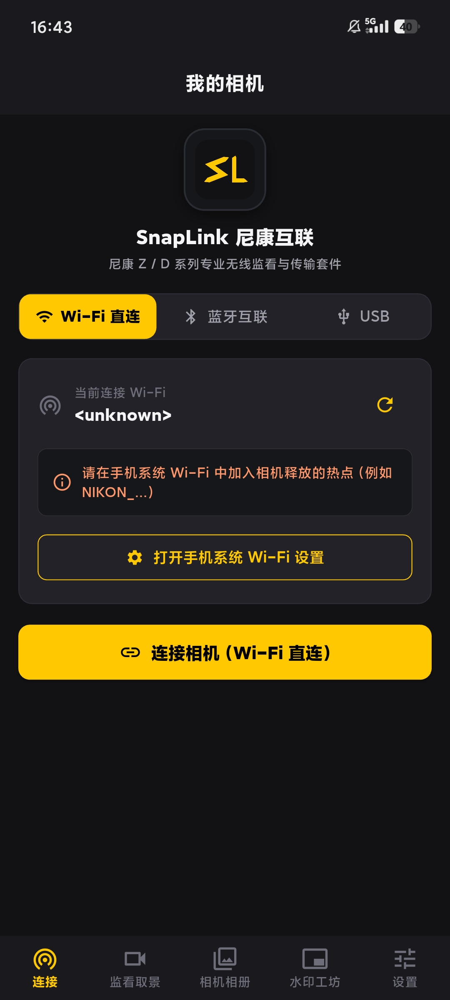
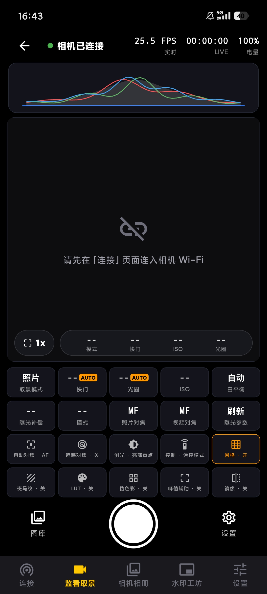
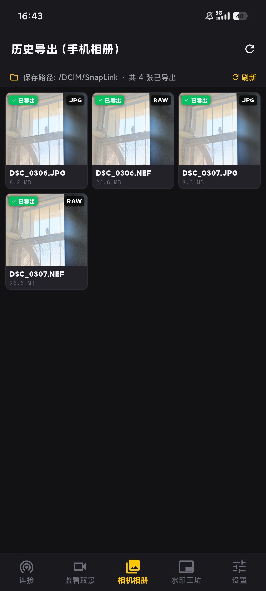
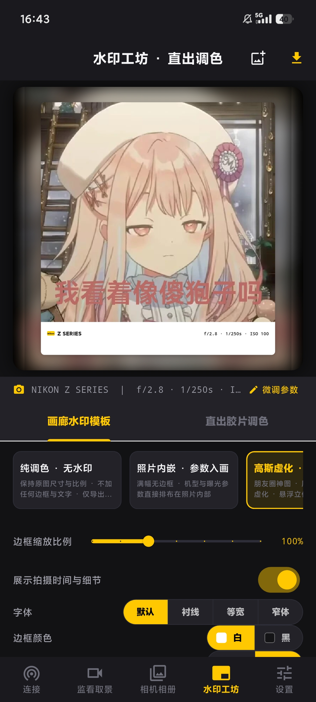
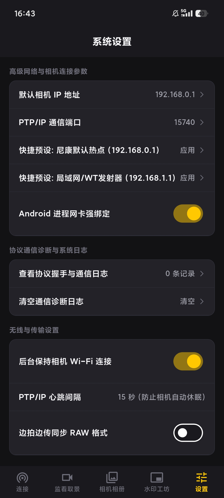

# SnapLink — 尼康相机无线互联、取景监看与水印工坊

<p align="center">
  
</p>

<p align="center">
  <b>专为尼康 (Nikon) Z 系列微单与 D 系列单反打造的移动端专业互联工具</b><br>
  <i>纯 Dart PTP/IP 协议栈 · 实时取景监看 · 分块高速下载 · 边拍边传 · 水印工坊与直出调色</i>
</p>

---

## 项目简介

SnapLink 是一款使用 Flutter 编写的开源摄影助手应用，解决的是一类很具体的问题：拍完照片想尽快把片子从相机传到手机、在手机上监看相机取景、并且给照片快速加上一行像样的参数水印——而不想依赖厂商 App 的账号体系、云服务和臃肿功能。

项目自带一套从零实现的 **纯 Dart PTP/IP 协议栈**，直接通过 TCP 双通道（Command + Event）与相机通信，不依赖任何原生桥接或第三方 SDK。应用整体采用深色摄影风格 UI（尼康金 + 暗黑），底部五个核心页面覆盖了从连接相机到出图的完整工作流：

| 页面 | 说明 |
|------|------|
| 连接 | Wi-Fi 直连 / 蓝牙互联 / USB 三种接入方式，附常用地址预设 |
| 监看取景 | 实时 LiveView 画面、直方图、曝光参数遥控、快门触发 |
| 相机相册 | 浏览相机存储卡，批量下载 JPG / RAW 并归档到手机相册 |
| 水印工坊 | 画廊卡片水印模板 + Lightroom 级直出调色，所见即所得 |
| 设置 | PTP/IP 网络参数、心跳保活、边拍边传、协议诊断日志 |

---

## 界面预览

### 连接

加入相机释放的 Wi-Fi 热点（如 `NIKON_...`）后一键建立 PTP/IP 连接，也支持蓝牙互联与 USB 通道。

<p align="center"></p>

### 监看取景

无线实时取景画面，顶部显示帧率、时长与电量，附 RGB 直方图；下方提供快门 / 光圈 / ISO / 白平衡等参数遥控栅格，以及斑马纹、LUT、伪色彩、峰值辅助、网格线等监看辅助开关，支持远程触发快门。

<p align="center"></p>

### 相机相册

浏览相机存储卡内的照片（JPG 与 NEF 原始RAW均可），批量导出到手机 `/DCIM/SnapLink` 目录，并自动记录已导出状态，避免重复下载。

<p align="center"></p>

### 水印工坊

内置多款画廊卡片式水印模板（纯调色无水印、参数入画、高斯虚化立牌等），可调节边框缩放、字体、边框颜色、拍摄时间等细节；「直出调色」标签页提供基于 4x5 色彩矩阵的胶片预设与 Lightroom 风格参数微调，导出时自动回写 EXIF。

<p align="center"></p>

### 设置

高级网络与相机连接参数（默认相机 IP、PTP/IP 端口、快捷预设）、协议握手与通信日志诊断、后台保持 Wi-Fi 连接、心跳保活间隔、边拍边传是否同步 RAW 等开关。

<p align="center"></p>

---

## 核心功能

### 连接与协议

- 纯 Dart 实现的 PTP/IP 客户端，管理 Command / Event 双 TCP 套接字与心跳保活，无需原生桥接。
- 支持 Wi-Fi 直连（相机热点）、蓝牙互联、USB 三种连接方式，设置页内置尼康默认热点（`192.168.0.1`）与局域网 / WT 发射器（`192.168.1.1`）快捷预设。
- 可配置 PTP/IP 通信端口（默认 `15740`）、心跳间隔（默认 15 秒，防止相机自动休眠）、Android 进程网卡强绑定等底层网络选项。
- 内置协议诊断模块，记录握手与通信日志，便于排查机型兼容问题。

### 实时取景 (LiveView)

- 通过尼康私有扩展操作码 `0x9201` 开启取景、`0x9428` 高速拉取 JPEG 帧，对旧机型自动回退 `0x9203` 协议。
- 监看 HUD：RGB 直方图、三分构图网格、中央对焦准心、安全框、斑马纹过曝预警、峰值辅助对焦、伪色彩与 LUT 预览。
- 遥控曝光参数：拍摄模式、快门、光圈、ISO、白平衡、曝光补偿、对焦模式、测光方式，并支持远程触发快门与数字变焦（1x / 2x / 4x）。
- 实时显示帧率、连接时长与相机电量。

### 传输

- 分块流式下载：调用 PTP `GetPartialObject (0x101B)` 按 4MB 分块拉取，高像素大图与 NEF 原始文件均可断点续传式下载。
- 边拍边传：监听相机 `ObjectAdded (0x4002)` 事件，拍摄后自动同步到手机相册，可选是否同步 RAW 格式。
- 导出历史管理：记录每张已导出文件与目标路径，相册页直接展示 JPG / RAW 标记与文件大小。

### 水印与调色

- 十余种画廊卡片式水印模板：电影宽幅遮幅、米白卡纸、圆角白卡、玻璃铭牌、背景高斯虚化立牌、沉浸单行参数等，支持边框缩放、字体（默认 / 衬线 / 等宽 / 窄体）、边框配色与拍摄时间展示开关。
- 参数自动填充：从 EXIF 提取机身型号、镜头、光圈、快门、ISO，一键排入水印。
- 直出调色引擎：基于 Adobe Lightroom 核心算法计算 4x5 色彩矩阵，提供胶片预设与曝光、对比、高光、阴影、色温、色调、饱和度、锐化、暗角、颗粒等完整参数微调，可组合水印模板一并导出。
- 导出时完整回写 EXIF 元数据并修正方向，画质无损。

---

## 技术实现

```
snaplink/
├── assets/icons/                  # 应用图标（SVG / PNG）
├── static/                        # README 使用的界面截图
├── lib/
│   ├── main.dart                  # 入口与全局配置
│   ├── core/
│   │   ├── constants/             # 色彩常量、网络配置、PTP 操作码（含尼康私有码）
│   │   ├── theme/                 # 暗黑摄影风格主题
│   │   └── utils/                 # 小端字节流读写、EXIF 解析、日志管理
│   ├── protocol/                  # 协议层
│   │   ├── ptp_packet.dart        # PTP/IP 封包拆包
│   │   ├── ptp_ip_client.dart     # 双 Socket 客户端与心跳保活
│   │   ├── camera_driver.dart     # 相机驱动抽象接口
│   │   ├── nikon_driver.dart      # 尼康专属驱动（LiveView / 调参 / 下载）
│   │   ├── nikon_ble_lss.dart     # 蓝牙互联
│   │   ├── nikon_liveview_parser.dart  # LiveView 帧解析
│   │   └── camera_native_bridge.dart    # 平台通道桥接（USB 等）
│   ├── engine/                    # 业务引擎
│   │   ├── liveview/              # 拉流循环、帧率调节、监看叠加层
│   │   ├── transfer/              # 分块下载、边拍边传、导出历史
│   │   ├── watermark/             # 模板定义、Canvas 排版、高清导出与 EXIF 回写
│   │   └── filter/                # 4x5 色彩矩阵调色引擎与胶片预设
│   └── ui/                        # 界面层
│       ├── screens/               # 连接 / 取景 / 相册 / 水印 / 设置 五个页面
│       ├── widgets/               # 通用组件、状态栏、直方图
│       └── root_scaffold.dart     # 底部导航容器
└── test/                          # 协议、水印、布局等单元测试
```

分层思路：`protocol` 只负责字节与连接，`engine` 只负责业务流程，`ui` 只负责展示与交互，三者通过相机驱动接口解耦，方便后续扩展新机型或新传输通道。

---

## 运行与构建

环境要求：Flutter 3.10+ / Dart 3.0+

```bash
cd snaplink
flutter pub get
flutter run          # 连接 Android / iOS 设备运行
```

构建 Android Release APK：

```bash
flutter build apk --release
# 产物：build/app/outputs/flutter-apk/app-release.apk
```

运行单元测试：

```bash
flutter test
```

使用步骤：

1. 打开相机的 Wi-Fi（网络菜单 → 启动无线连接），手机加入相机释放的热点。
2. 打开 SnapLink，在「连接」页点击「连接相机」。
3. 连接成功后即可使用取景监看、相册下载、水印导出等功能。

---

## 兼容性说明

- 机型：面向尼康 Z 系列微单与 D 系列单反，协议层对新旧 LiveView 操作码做了自动回退，具体机型欢迎实测反馈。
- 平台：以 Android 为主要目标平台（已验证），iOS / 桌面端理论可编译但未完整验证。
- 本项目为独立开发的第三方工具，与 Nikon 官方无关联、未使用其专有 SDK；「Nikon」「Z SERIES」等名称仅用于标识兼容机型。

---

## 开源许可

本项目采用 [MIT License](LICENSE) 开源，欢迎提交 Issue 与 Pull Request。
